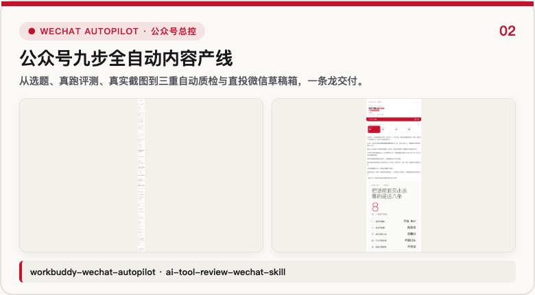
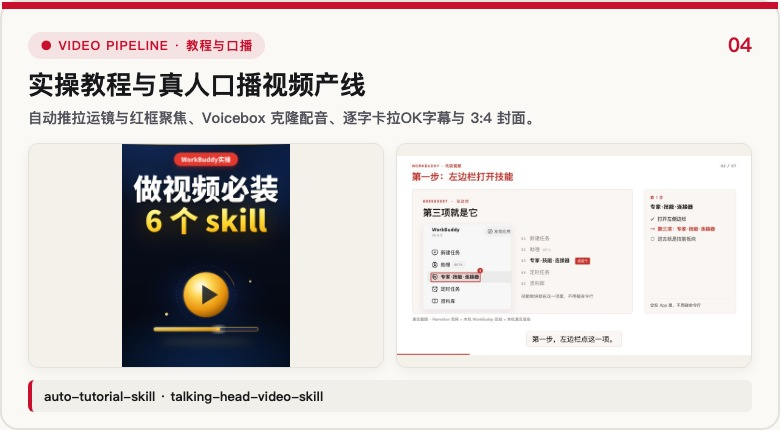
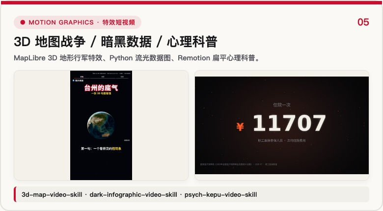
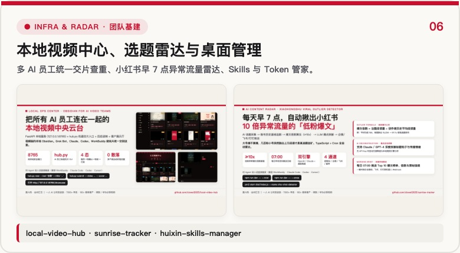
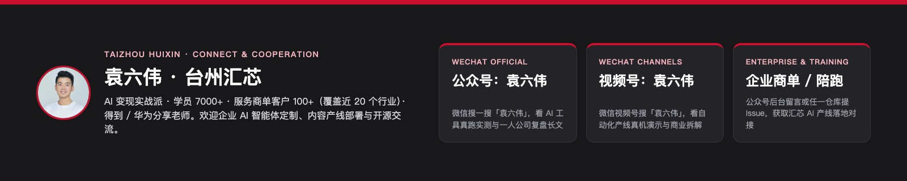

<div align="center">


# 台州汇芯 · 袁六伟

### 把行业经验 + AI 杠杆，做成能持续收钱的一人公司与自动化产线

[](https://github.com/sixwei2025)
[](#四大开源产品矩阵)
[](#关于台州汇芯与商务合作)
[](#新手 30 秒安装)

> 🔴 **我是袁六伟，台州汇芯创始人**｜一人 AI 公司实战派，学员 **7000+**，服务企业商单客户 **100+**（覆盖近 **20** 个行业），得到 / 华为分享老师。  
> 📮 更多 AI 工具真跑实测与自动化工作流，欢迎微信搜一搜关注 **公众号 / 视频号：袁六伟**

[本周主推](#-本周主推从这两个仓库开始) · [四大产品矩阵](#-四大开源产品矩阵) · [全仓库速查表](#-全仓库速查表) · [新手 30 秒安装](#-新手-30-秒安装把链接发给-ai-就行) · [合作与关注](#-关注与商务合作)

</div>

---

## 🔥 本周主推：从这两个仓库开始

| 旗舰方向 | 推荐仓库 | 一句话解决什么问题 | 直达入口 |
| :--- | :--- | :--- | :--- |
| **自媒体全自动总控** | **`workbuddy-wechat-autopilot`** | 选题 → 写稿 → 真实截图 → 6 套杂志封面 → 6 套内联排版 → 三重自动质检 → 直投微信草稿箱 | [打开仓库 →](https://github.com/sixwei2025/workbuddy-wechat-autopilot) |
| **一人公司方法论** | **`yuanliuwei-ai-skills`** | 内置 **PACT 72 小时零成本需求验证器** 与一人 AI 公司 10 大业务决策模块，先收钱验证再开发 | [打开仓库 →](https://github.com/sixwei2025/yuanliuwei-ai-skills) |

---

## 🧱 四大开源产品矩阵

<table width="100%">
  <tr>
    <td width="50%" valign="top">
      <a href="https://github.com/sixwei2025/yuanliuwei-ai-skills">
        
      </a>
      <br />
      <strong>01 · 一人 AI 公司方法论与认知基座</strong><br />
      先做 72 小时需求验证再写代码，把行业经验拆成可收钱的最小闭环；同步提供书籍方法论蒸馏与历史决策框架。<br />
      👉 <a href="https://github.com/sixwei2025/yuanliuwei-ai-skills">yuanliuwei-ai-skills</a> · <a href="https://github.com/sixwei2025/book-skill">book-skill</a> · <a href="https://github.com/sixwei2025/huangdi-skill">huangdi-skill</a>
    </td>
    <td width="50%" valign="top">
      <a href="https://github.com/sixwei2025/workbuddy-wechat-autopilot">
        
      </a>
      <br />
      <strong>02 · 公众号九步全自动内容产线</strong><br />
      从选题查重、真跑工具评测、真实截图配图，到去 AI 味润色质检与草稿箱投递，告别手动复制粘贴。<br />
      👉 <a href="https://github.com/sixwei2025/workbuddy-wechat-autopilot">workbuddy-wechat-autopilot</a> · <a href="https://github.com/sixwei2025/ai-tool-review-wechat-skill">ai-tool-review-wechat-skill</a>
    </td>
  </tr>
  <tr>
    <td width="50%" valign="top">
      <a href="https://github.com/sixwei2025/wechat-cover-skill">
        
      </a>
      <br />
      <strong>03 · 杂志级封面与百万阅读排版引擎</strong><br />
      汇芯红 <code>#C8102E</code> 六套 100% 内联 CSS 骨架 + 6 套杂志风封面防遮挡校验 + 10 条高浓缩爆款短标题。<br />
      👉 <a href="https://github.com/sixwei2025/wechat-cover-skill">wechat-cover-skill</a> · <a href="https://github.com/sixwei2025/gzh-million-layout-skill">gzh-million-layout-skill</a> · <a href="https://github.com/sixwei2025/hit-title-expert-skill">hit-title-expert-skill</a>
    </td>
    <td width="50%" valign="top">
      <a href="https://github.com/sixwei2025/auto-tutorial-skill">
        
      </a>
      <br />
      <strong>04 · 实操教程与真人口播视频产线</strong><br />
      网页/真机截图自动推拉运镜与红框聚焦、Voicebox 克隆配音、逐字卡拉OK字幕与 3:4 封面同步出片。<br />
      👉 <a href="https://github.com/sixwei2025/auto-tutorial-skill">auto-tutorial-skill</a> · <a href="https://github.com/sixwei2025/talking-head-video-skill">talking-head-video-skill</a>
    </td>
  </tr>
  <tr>
    <td width="50%" valign="top">
      <a href="https://github.com/sixwei2025/3d-map-video-skill">
        
      </a>
      <br />
      <strong>05 · 3D 地图战争 / 暗黑数据 / 心理科普</strong><br />
      MapLibre 3D 地形行军特效、Python + FFmpeg 流光数据可视化、Remotion 驱动的扁平心理科普动画。<br />
      👉 <a href="https://github.com/sixwei2025/3d-map-video-skill">3d-map-video-skill</a> · <a href="https://github.com/sixwei2025/dark-infographic-video-skill">dark-infographic-video-skill</a> · <a href="https://github.com/sixwei2025/psych-kepu-video-skill">psych-kepu-video-skill</a>
    </td>
    <td width="50%" valign="top">
      <a href="https://github.com/sixwei2025/local-video-hub">
        
      </a>
      <br />
      <strong>06 · AI 团队基建、选题雷达与桌面效率</strong><br />
      多 AI 员工统一交片查重的本地视频中心、小红书早 7 点低粉爆文雷达，以及汇芯 Skills / Token / 内容管家。<br />
      👉 <a href="https://github.com/sixwei2025/local-video-hub">local-video-hub</a> · <a href="https://github.com/sixwei2025/sunrise-tracker">sunrise-tracker</a> · <a href="https://github.com/sixwei2025/huixin-skills-manager">huixin-skills-manager</a>
    </td>
  </tr>
</table>

---

## 📋 全仓库速查表

<details>
<summary><strong>点击展开查看完整开源矩阵（按业务领域分类）</strong></summary>

| 分类 | 仓库名称 | 核心能力 |
| :--- | :--- | :--- |
| **方法论与认知** | [**yuanliuwei-ai-skills**](https://github.com/sixwei2025/yuanliuwei-ai-skills) | PACT 72h 需求验证模型与一人 AI 公司 10 大业务决策模块 |
| **方法论与认知** | [**book-skill**](https://github.com/sixwei2025/book-skill) | 上传任意书籍 PDF → 自动提炼方法论生成 Skill 与公众号导流文案 |
| **方法论与认知** | [**huangdi-skill**](https://github.com/sixwei2025/huangdi-skill) | 中国历史八大皇帝一手史料认知框架蒸馏 |
| **公众号产线** | [**workbuddy-wechat-autopilot**](https://github.com/sixwei2025/workbuddy-wechat-autopilot) | 九步全自动总控：选题 → 写稿 → 真图 → 封面 → 排版 → 三重质检 → 草稿箱 |
| **公众号产线** | [**ai-tool-review-wechat-skill**](https://github.com/sixwei2025/ai-tool-review-wechat-skill) | AI 工具真跑评测工作流（全自动压测 + 去 AI 味润色 + 六套骨架装配） |
| **公众号产线** | [**wechat-cover-skill**](https://github.com/sixwei2025/wechat-cover-skill) | 6 套高客单价杂志风封面引擎 + 黑红金主题 + 防压脸自动校验 |
| **公众号产线** | [**gzh-million-layout-skill**](https://github.com/sixwei2025/gzh-million-layout-skill) | 汇芯红 `#C8102E` 六套 100% 内联 CSS 骨架 + 零乱码排版检查 |
| **公众号产线** | [**hit-title-expert-skill**](https://github.com/sixwei2025/hit-title-expert-skill) | 一次直出 10 条 14–22 字高浓缩爆款短标题（5 大公式 × 5 类钩子词） |
| **短视频工程** | [**auto-tutorial-skill**](https://github.com/sixwei2025/auto-tutorial-skill) | 链接 / 网页 / 真机截图 → 3:4 封面 + 1.5x 配音 + 红框聚焦教程视频 |
| **短视频工程** | [**talking-head-video-skill**](https://github.com/sixwei2025/talking-head-video-skill) | 1080×1920 竖屏真人口播短视频（ASR 错字校对 + 逐字字幕 + 6 项质检） |
| **短视频工程** | [**3d-map-video-skill**](https://github.com/sixwei2025/3d-map-video-skill) | MapLibre 3D 地形 + WarFX 战争特效（粒子行军 / 点阵兵力 / 震屏混音） |
| **短视频工程** | [**dark-infographic-video-skill**](https://github.com/sixwei2025/dark-infographic-video-skill) | 纯 Python + FFmpeg 暗黑流光数据可视化科普片（含手机外放优化配乐） |
| **短视频工程** | [**psych-kepu-video-skill**](https://github.com/sixwei2025/psych-kepu-video-skill) | Remotion + JSON 驱动的 15–30s 深色扁平动画心理科普短视频 |
| **基建与雷达** | [**local-video-hub**](https://github.com/sixwei2025/local-video-hub) | 本地视频中心：多 AI 员工统一交片、撞题查重与四态流转工作台 |
| **基建与雷达** | [**sunrise-tracker**](https://github.com/sixwei2025/sunrise-tracker) | 小红书 AI 赛道 10 倍异常流量「低粉爆文」每日早 7 点监测推送 |
| **桌面与生态工具** | [**huixin-skills-manager**](https://github.com/sixwei2025/huixin-skills-manager) | 汇芯桌面端 Skills 管理工具 |
| **桌面与生态工具** | [**huixin-token-manager**](https://github.com/sixwei2025/huixin-token-manager) | 汇芯多平台 Token 统一管理与检测工具 |
| **桌面与生态工具** | [**huixin-content-manager**](https://github.com/sixwei2025/huixin-content-manager) | 汇芯内容资产与多端发布管理客户端 |
| **桌面与生态工具** | [**antigravity-zh-solution**](https://github.com/sixwei2025/antigravity-zh-solution) | Antigravity 中文环境与工程实践配套方案 |

</details>

---

## 🚀 新手 30 秒安装：把链接发给 AI 就行

如果你不想记任何命令行，打开 **Codex、WorkBuddy** 或其他支持技能安装的 AI 智能体，直接把下面这句话发给它：

```text
帮我安装这个仓库里的技能：
https://github.com/sixwei2025/yuanliuwei-ai-skills
```

> 你可以把上面的仓库地址换成列表里任意一个你想用的 Skill 仓库。安装完成后，直接问 AI：**「这个技能怎么用？带我做一个最简单的例子。」**

---

## 🤝 关于台州汇芯与商务合作

- **公司定位**：**台州汇芯** —— 专注帮一人公司与中小企业用 AI Agent 搭建低成本、高确定性的自动化业务产线。
- **实战基线**：累计教学学员 **7,000+**，服务企业商单客户 **100+**（覆盖近 **20** 个行业），受邀担任 **得到 / 华为** 分享老师。
- **可对接业务**：企业 AI 智能体与工作流定制落地、全自动公众号/短视频内容产线部署、一人 AI 公司商业闭环陪跑。

---

## 📮 关注与商务合作

<div align="center">



**微信公众号**：微信搜一搜 **`袁六伟`** ｜ **微信视频号**：搜 **`袁六伟`** ｜ **开源主页**：[github.com/sixwei2025](https://github.com/sixwei2025)

*如果这些开源产线帮你省下了每天反复返工的时间，欢迎给喜欢的仓库点个 ⭐ **Star**！*

</div>
