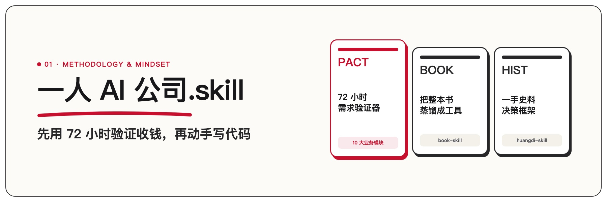
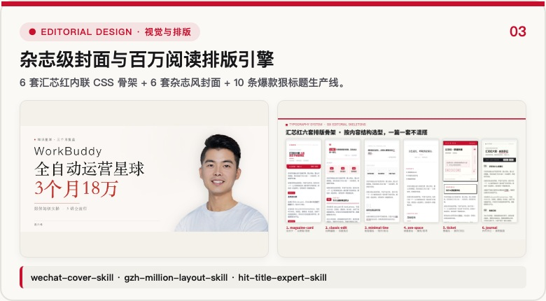
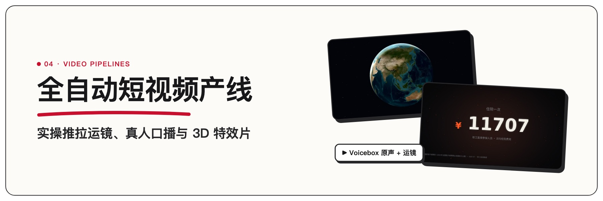
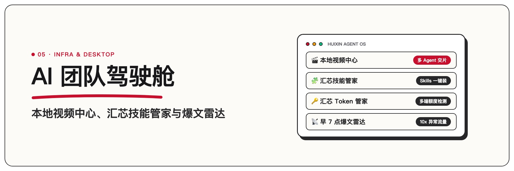

我是**袁六伟**，**台州汇芯**创始人，**得到 / 华为的分享老师**，**多家企业的 AI 落地顾问**。累计带出实战学员 **7000+**，交付企业商单 **100+**（覆盖近 **20** 个行业）。从一人 AI 公司方法论，到公众号与短视频全自动流水线，这里只开源我自己每天真跑、能收钱的 Agent Skills。

[](https://github.com/sixwei2025)
[](https://github.com/sixwei2025)
[-2563EB?style=flat)](https://github.com/sixwei2025)
[](https://github.com/sixwei2025?tab=repositories)

---

## 从这里开始

[](https://github.com/sixwei2025/yuanliuwei-ai-skills)

内置 **PACT 72 小时零成本需求验证器** 与一人 AI 公司 10 大业务决策模块，把行业经验拆成可收钱的最小闭环。 [打开一人公司总库 →](https://github.com/sixwei2025/yuanliuwei-ai-skills)

也可以直接试试：[书籍方法论蒸馏 book-skill](https://github.com/sixwei2025/book-skill) · [历史决策框架 huangdi-skill](https://github.com/sixwei2025/huangdi-skill)

[](https://github.com/sixwei2025/workbuddy-wechat-autopilot)

九步闭环工作流：选题防撞车检查、工具真跑实测、真实截图配图、去 AI 味润色把关，一键推入微信草稿箱。 [打开公众号总控 →](https://github.com/sixwei2025/workbuddy-wechat-autopilot) · [AI 工具评测产线 →](https://github.com/sixwei2025/ai-tool-review-wechat-skill)

## 给内容配上视觉与视频产线

[](https://github.com/sixwei2025/wechat-cover-skill)

汇芯红 `#C8102E` 品牌主视觉、防压脸自动校验、零乱码 100% 内联 CSS 骨架，以及 10 条高浓缩爆款短标题生成。 [打开封面引擎 →](https://github.com/sixwei2025/wechat-cover-skill) · [百万阅读排版 →](https://github.com/sixwei2025/gzh-million-layout-skill) · [爆款标题专家 →](https://github.com/sixwei2025/hit-title-expert-skill)

[](https://github.com/sixwei2025/auto-tutorial-skill)

真实界面自动推拉运镜与红框聚焦、Voicebox 本人原声克隆配音、3:4 竖版封面内嵌第 0.01 帧，以及 3D 地形、暗黑流光数据与心理科普动画。 [实操教程视频 →](https://github.com/sixwei2025/auto-tutorial-skill) · [真人口播视频 →](https://github.com/sixwei2025/talking-head-video-skill) · [3D 地图战争 →](https://github.com/sixwei2025/3d-map-video-skill) · [暗黑数据流光 →](https://github.com/sixwei2025/dark-infographic-video-skill) · [心理科普动画 →](https://github.com/sixwei2025/psych-kepu-video-skill)

## 给团队配上桌面与雷达基建

[](https://github.com/sixwei2025/local-video-hub)

多 AI 员工统一交片查重的本地视频中心、汇芯技能管家、汇芯 Token 管家，以及小红书每日早 7 点 10 倍异常流量「低粉爆文」雷达。 [本地视频中心 →](https://github.com/sixwei2025/local-video-hub) · [汇芯技能管家 →](https://github.com/sixwei2025/huixin-skills-manager) · [Token 管家 →](https://github.com/sixwei2025/huixin-token-manager) · [早 7 点爆文雷达 →](https://github.com/sixwei2025/sunrise-tracker) · [内容管家 →](https://github.com/sixwei2025/huixin-content-manager) · [Antigravity 汉化 →](https://github.com/sixwei2025/antigravity-zh-solution)

## 新手 30 秒安装：把链接发给 AI

打开 **Codex、WorkBuddy** 或其他支持技能安装的 AI 智能体，直接把下面这段话发到对话框，让它帮你安装：

```text
帮我安装这个仓库里的技能：
https://github.com/sixwei2025/yuanliuwei-ai-skills
```

安装后可以直接问 AI：「**这个技能怎么用？带我做一个最简单的例子。**」（把上面的链接换成任意一个你想安装的仓库地址即可。）

## 一起把 AI 产线跑通


**微信公众号 / 视频号**：微信搜一搜 **「袁六伟」** · [查看全部 20 个开源仓库 →](https://github.com/sixwei2025?tab=repositories)
